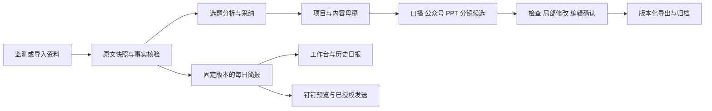

# EcuStudio教创工作台产品需求文档

> 实施更新（2026-11-08，文档1.2）：用户已授权开发、启动和测试，并指定 DeepSeek 内置 Agent。本文保留1.1需求/设计基线；当前实现和外部条件见[04 DeepSeek Agent实施补充](04_DeepSeek_Agent实施补充.md)及应用验收报告。本文原有“未执行/仅文档”指最初文档阶段，不代表当前状态。

版本：1.1 ｜ 日期：2026-11-08 ｜ 状态：供评审与开发拆解

产品：EcuStudio教创工作台  
内容引擎：EduContent Studio，Skill 标识 `educontent-studio`  
读者：产品负责人、设计、开发、测试及业务验收人员

本产品把教育信息发现、事实核验、选题和多格式创作连接起来。V1 面向本地单用户，首要服务北京初三及中考内容生产，同时支持北京高考与相关国家政策。核心交付是可持续保存资料、可追溯事实、可编辑并导出成果的工作台。

本套文件是需求与开发设计，不代表软件已实现。三份输入均为开发提示词，不能据此认定已有 Skill、模型授权、钉钉连接或运行服务。本文新增的数值门槛与实施细则均为建议基线，待实施时结合环境验证。

## 1 编制依据与范围决策

| 来源 | 文档 | 本版使用方式 |
|---|---|---|
| S1 | EduContent_Studio_WorkBuddy_Complete_Prompt (1).md | 保留政策研究、内容母稿、多格式创作、精确改稿和成果质量要求 |
| S2 | jingjieleida-workbuddy-prompt.md | 补充监测、来源分级、评分、每日简报、钉钉与历史查询细则 |
| S3 | 京教雷达工作台 Codex 搭建提示词.md，版本 1.0，2026-11-08 | 作为当前 V1 范围主线；采用其架构边界、版本关系和 A01—A18 验收要求 |

S3 第 1 节明确将原 Skill 扩展为工作台，并取消参赛打包要求。因此，S1 的“禁止工作台和数据库”与参赛命名不再约束本版；Skill 的专业方法继续保留。S2 中 WorkBuddy 能力可用的陈述作为待验证条件，不能当作环境事实。详细追溯见《03_需求追溯与验收计划》。

### 1.1 默认产品边界

- 本地优先、单用户、浏览器访问；首版优先 Windows，macOS 提供说明并单列实测状态。
- 资料、数据库、母稿及成果存入用户选择的本地数据目录；默认建议 `D:\EduStudio\data`，原始需求文件不作为运行数据。
- 默认地区北京，覆盖相关国家政策；默认过去 48 小时，可选 24/72 小时、7 天和自定义范围。
- 计划每天 09:00 启动，时区 Asia/Shanghai，包含周末。展示实际完成时间，不承诺 09:00 已全部完成。
- 默认简体中文；优先闭环为政策研究、内容母稿、90 秒口播、讲座 PPT，并完成公众号与分镜出口。
- 不在 V1 建设公网、多租户、付费系统、社交账号自动发布、付费视频批量生成、桌面壳或通用 Agent 平台。
- 运营 Excel/CSV 分析、更多模板与来源、全文检索优化属于后续增强；JSON/CSV 数据导出属于 V1。

### 1.2 交付层次

“V1 核心”表示完整交付必须覆盖；“条件验收”表示功能与适配器属于 V1，但真实外部调用需具备明确条件；“增强”不阻塞 V1。阶段划分只安排先后，不允许用静态界面替代完整 V1。

## 2 用户与目标

| 用户 | 主要任务 | 当前问题 | 产品提供的价值 |
|---|---|---|---|
| 教育内容运营 | 每日发现政策、选题和交稿 | 多来源分散，重复整理，同一数字在多稿中不一致 | 统一情报、母稿和成果版本 |
| 升学研究人员 | 对照条款、解释适用条件 | 年份、区县、人群与政策状态容易混淆 | 原文定位、事实核验和新旧政策差异 |
| 自媒体作者或讲师 | 口播、公众号、讲座与分镜 | 重复转写，PPT 只有大纲，修改牵连无关内容 | 可编辑文件、稳定内容块和局部修改 |

角色是同一用户的工作身份，不引入多人权限系统。面向家长和学生的内容是成果受众，不意味着家长或学生需要登录工作台。

### 2.1 成功标准

1. 能从一份真实官方材料建立可定位证据、母稿与同源的口播、公众号、PPTX、分镜。
2. 正式政策推荐中的关键事实可追溯且通过核验；可发布成果额外绑定编辑确认。
3. 原文修订或母稿变化后可找到所有受影响成果，历史文件仍可复现。
4. 每日流程、界面、历史日报、导出与钉钉使用相同日报版本。
5. 重启、断线、重试和失败不会静默丢稿、重复提交或伪造完成状态。

不预设已节省多少时间或提升多少效率。建议验收后，以同一组材料比较人工流程与辅助流程，记录实际操作时间、核验时间、人工改稿量和文件质量；没有测量前不对外声称量化收益。

## 3 核心用户流程

### 3.1 每日发现和选题

用户打开今日工作台，看到最近成功数据时间、监测窗口和本次覆盖情况；可手动更新或等待计划任务。系统采集、去重和核验后生成正式推荐与待核验列表。用户查看证据和评分、收藏或采纳选题，一次点击创建项目并继承资料，不需要重新粘贴原文。

### 3.2 一稿多用

用户选择项目受众、年度和成果类型。系统提取 claim，建立母稿候选，用户修订和确认。之后按需生成一种或多种成果；每份绑定明确母稿版本。自动检查通过后，用户审阅、修改并确认具体内容版本，再导出可发布文件。只有一个输出需求时不强制生成全套。

### 3.3 修订与重新审核

同一来源正文变化产生新快照。系统列出受影响事实、母稿与成果，标记“依据已更新，待复核”。用户比较新旧内容、接受部分修改或保留旧稿。新版本重新审核；历史文件与审核记录保持不变。

### 3.4 无模型时继续工作

首次启动无需私有凭据即可导入资料、人工核验、管理选题、编辑母稿、查看历史和导出已有内容。AI 按钮显示“待配置”及具体入口。任务包可供外部执行后导回，但必须标明“外部执行／人工导入”，不能显示为自动接通。

## 4 功能需求

### R01 资料导入与来源管理

级别：V1 核心。依据：S1 §05—06；S2 §4；S3 §6。

支持 URL、粘贴原文、文本 PDF、DOCX、Markdown、TXT、HTML。PPTX 文字提取、图片和扫描件 OCR 根据解析能力启用；不支持时给出原因与人工输入入口。导入先显示提取预览、标题、机构、年度、来源信息和解析异常，用户可更正元数据，更正记录不能覆盖原始提取值。

来源分 A 官方、B 可信媒体、C 公开讨论。官方来源仍需核对适用边界；转载保留原始来源关系。来源配置包括地区、类别、入口、频率、最近成功时间和错误。首批建议接入 2—3 个实际可访问官方来源，不把建议数量当作现有能力。

分别记录发布日期、页面更新时间、采集时间、适用年度、生效和失效时间。未知日期为空并保留原因。快照按正文哈希版本化；URL 规范化去重，语义相似只能生成合并候选，不能直接误删不同政策。

验收：重复导入不重复计数，同 URL 正文变化创建新快照；不可解析文件不误报成功；原文、引用片段和来源关系可查询。

### R02 事实核验与证据

级别：V1 核心。依据：S1 §05；S2 §5.1；S3 §7.1。

核验单位为 claim，包含事实陈述、年份、区县、学段、人群、条件、例外、原文片段、来源快照和页码或段落定位。事实状态为已核实、部分核实、待核实、已排除；来源级别、事实状态、编辑审核分开呈现。

关键事实包括日期、人数、比例、分数、资格、录取规则和适用范围。缺原文、冲突未解或范围不清的关键事实不得进入正式政策推荐与可发布成果；允许保存清楚标记的研究草稿。模型置信度不能单独证明核验；多个转载不算独立交叉证据；发布时间较晚不等于替代旧政策。

核验记录保留方法、操作者、时间、证据与排除原因。排除不物理删除。政策替代、撤销和过期需有明确依据或人工核实记录。

验收：往年、异地、征求意见稿不会被当作当年北京已实施政策；点击引用可找到对应原文；冲突具有解决记录。

### R03 智能选题与可解释评分

级别：V1 核心，AI 分析为条件验收。依据：S2 §5.2—5.4；S3 §8。

选题包含事实摘要、政策内容、北京升学关联、家长学生影响、机构参考价值、建议标题、角度、受众、形式、来源、时间与核验状态。支持关键词搜索、地区／区县／学段／年度／来源／状态筛选、时间／评分／重要度排序、收藏、备注、采纳、搁置、归档。

| 评分维度 | 分值上限 | 依据要求 |
|---|---:|---|
| 北京教育升学相关性 | 30 | 说明与目标地区、人群和学段的联系 |
| 时效性 | 20 | 依据已知发布日期、更新及窗口，未知不虚填 |
| 学生家长实际影响 | 20 | 说明决策、资格、节点或成本影响 |
| 内容与传播价值 | 15 | 说明可解答的问题，不虚构平台热度 |
| 完整度与可操作性 | 15 | 说明证据、条件和可执行建议是否齐备 |

总分为各分项之和，显示评分规则版本及理由；评分规则建议见开发文档。真实性是前置门槛。TOP 3、TOP 10 不足时按实际数量展示；禁止补造资讯。没有真实来源的阅读量、热榜名次不显示。分数标注“系统选题评分”。

选题生命周期：待评估 → 已采纳 → 制作中 → 待审核 → 已完成 → 已归档；可退回并记录理由。搁置用独立标记表示，不与生命周期冲突。一选题可关联多个项目，重复点击创建操作返回同一结果，明确新建第二个项目时才新增。

### R04 项目与内容母稿

级别：V1 核心。依据：S1 §05；S3 §7.2、8。

项目保存主题、地区、区县、学段、政策年度、受众、来源与品牌／角色设置。Content Master 保存已核实事实及 claimId、关键数字和条件、待核实项、冲突、观点、受众问题、风格、不可改动块和变更记录。

已提交版本不可变；编辑从已有版本创建新版本。自动保存显示保存中、已保存、失败；多标签页冲突提供比较，不静默覆盖。编辑确认绑定具体版本和依赖版本，新版本不能继承旧确认。依赖变化对所有派生成果产生过期提示。

### R05 多格式内容生产

级别：V1 核心，真实 AI 生成须条件验收。依据：S1 §06；S2 §10；S3 §9。

| 成果 | 用户输入 | 必须输出 | 验收要点 |
|---|---|---|---|
| 政策解读 | 材料、受众、地区、年度 | 条款解释、关键时间数字、问答、风险与引用 | 观点与事实分开，适用范围不丢失 |
| 真人口播 | 30/60/90 秒、3 分钟或自定义 | 标题、开场、分段台词、停顿、画面建议、结尾、发布文案 | 时长标为估算，说明语速，不删关键例外 |
| 公众号 | 篇幅、受众、风格 | 标题备选、摘要、正文、配图位置与提示词、来源 | Markdown 编辑、手机预览、复制排版内容与导出 |
| 讲座 PPT | 受众、时长或页数、重点、Logo、风格 | 大纲、逐页内容、讲者备注、真实 PPTX | 默认 16:9，可编辑文字图形；大纲、页序可调整 |
| 视频分镜 | 时长、人物、场景、模型偏好 | 编号、时长、动作、景别、运镜、光线、台词、字幕、连续性、提示词 | 总时长可校核；未核实模型参数用通用描述 |
| 角色模板 | 身份、外貌、参考图、声音习惯 | 稳定身份与可变造型配置 | 参考图为真实资产，不假定外部平台自动获得图片 |

演示 PPT 可用 10—15 页；两小时讲座按内容与讲述节奏规划，不能固定压缩成演示页数。工作台使用暖白墨绿，默认 PPT 可沿用 S1 的深蓝白专业风格，两种视觉不冲突。

公众号复制样式与独立 HTML 是不同出口；未经实际粘贴测试不宣称兼容平台编辑器。V1 不自动发公众号，不直接生成付费视频。至少提供政策研究、口播、公众号、PPT、分镜五类带字段的启动模板。

### R06 精确修改与审核

级别：V1 核心。依据：S1 §07；S3 §7.2、9.5。

段落、幻灯片和镜头使用稳定 ID。用户限定范围后，AI 返回候选补丁与差异，支持逐项接受和放弃。只改第 5 页标题时，其余页与备注不变；涉及事实变化时显式告知关联影响。跨成果检查覆盖日期、数字、机构、人群、条件与例外，并允许人工解释误报。

审核状态为未审核、需修改、已确认。可发布导出同时要求关键事实核验通过、当前成果版本确认、依赖未过期和质量阻断项清零。研究草稿允许导出但必须有标识。审核与导出门禁由服务端执行。

### R07 Skill 与执行器接入

级别：V1 核心，宿主及模型实连为条件验收。依据：S3 §3、5。

Skill 注册显示 ID、版本、来源、哈希、工作流、依赖工具及验证状态。支持目录／ZIP 导入、重扫、差异查看和版本选择。导入前检查路径、文件与依赖，不自动运行安装脚本。一次任务固定 Skill 快照。

找到原 Skill 时保留原包并映射；只有提示词时据此新建工作流包，注明本次实现；缺文件时注明未与原包比较。不能把提示词文件登记成已运行 Skill。

执行器选择已验证原生接口，或工作台内受控工作流；界面清楚标识使用路径。开发助手可调用的工具不自动属于应用。输入、模型输出、工具权限、预算和文件都需校验。结果要有真实日志、版本及文件，不能只有一段返回文本。

### R08 持久任务与每日更新

级别：V1 核心。依据：S2 §7；S3 §12。

研究、采集、生成和导出均进入后台任务。页面刷新后仍可恢复任务进度；状态包括排队、运行、等待输入、成功、部分成功、失败、取消和中断。显示实际阶段、错误和可操作的恢复入口，不显示虚构百分比。

每天 09:00 固定配置和时间窗口，依次采集、核验去重、选题分析、生成日报、原子提交、更新页面、生成通知任务。内置或已验证原生调度只能选一个。计划配置持久化，可启停、调整关键词／地区／窗口，显示下次运行时间。

电脑关机、休眠或后台退出时不会运行。恢复默认只补最近 24 小时内错过的最近一次任务，更早记录为漏跑并支持手动补采。补跑显示真实完成时间，不回填伪造历史日报。

重复任务创建不重复写入；重新生成是明确的新操作。某些来源失败可提交标明覆盖不足的部分日报；全部采集失败保留上一份成功日报。无可靠新增与采集失败分别展示。PPT 或通知失败不回滚日报。

### R09 日报与历史档案

级别：V1 核心。依据：S2 §5.4、6；S3 §12—15。

日报保存日期、时区、窗口、任务、配置与规则版本、实际完成时间、来源覆盖、统计、TOP 3、推荐列表、变化提醒与来源清单。一天可有多个不可变版本；“最新成功版本”用于默认展示，历史版本仍可访问和导出。

| 指标 | 本版口径 |
|---|---|
| 检索候选数 | 本轮去重前发现的候选记录数量，与抓取请求次数分开 |
| 有效情报数 | 窗口内适用且未被排除的独立政策／事件数，部分核实可计入但必须有状态 |
| 新增信息数 | 本轮首次入库且日期符合窗口的独立条目，修订不计新增 |
| 修订信息数 | 已有条目产生新快照并有实质变化的数量 |
| 已核实信息数 | 有效情报中，正式呈现所需关键事实均已核实的数量 |
| 推荐选题数 | 本轮通过真实性门槛的去重选题数 |
| 高优先级选题数 | 推荐分数不低于 80 分，80 为可配置的建议初值 |
| 已核实来源数 | 本轮被有效已核实事实引用的不同来源 ID 数，不等于 claim 数 |

发布日期未知的资料留在资料库并提示时间待核实，不作为“今日新增”；长期政策独立归档。历史比较呈现新增、修订、失效与推荐变化，不能仅比较标题。

### R10 钉钉同步

级别：V1 核心适配器，真实发送为条件验收。依据：S2 §8；S3 §13。

提供安全配置、连接检查、目标展示、消息预览和独立发送记录。正文直接使用日报版本，包括日期、窗口、数量、完成时间、TOP 3、分数、摘要、选题价值、真实来源链接和任务标识。按实际平台限制分段，不发送接收者无法访问的 localhost 工作台地址。

首次真实测试需明确目标和发送授权；自动发送另由用户启用。未配置、未授权、已发送、失败、结果待确认分别显示。已成功消息不重复发送；超时结果不明时不盲目重发；可以单独重试通知。凭据不进入前端、日志或导出。

### R11 导出与成果中心

级别：V1 核心。依据：S1 §06；S2 §9；S3 §14。

| 范围 | 支持格式 |
|---|---|
| 单条情报、日报、当前筛选结果 | Markdown、独立 HTML、PDF、DOCX；结构化列表可导出 JSON/CSV |
| 项目母稿、口播、文章、分镜 | Markdown、独立 HTML、PDF、DOCX、结构化 JSON；分镜表可导出 CSV |
| 项目演示稿 | 可编辑 PPTX；其他格式按大纲／讲义导出，并标明不是幻灯片保真转换 |
| 单个项目交付包 | 选择成果与清单打包，原始资料仅在用户明确选择且有权分享时加入 |

所有导出固定数据版本和筛选快照。文件验证存在、非空、类型与结构正确后登记；失败不给虚假下载链接。MD 保留引用；HTML 内联必要样式、可离线阅读；PDF 中文、分页、页码和链接正确；DOCX/PPTX 为真正 OOXML，不改后缀冒充文件。

导出显示年度、核验与审核状态、生成时间、来源与版本。DOCX/PPTX 做结构及可用渲染检查；缺渲染条件标记“视觉未验证”，不冒充全部检查通过。示例命名：`EcuStudio教创工作台_每日情报_YYYY-MM-DD_vN.docx`。

### R12 备份恢复与数据归属

级别：V1 核心。依据：S3 §15—16。

提供数据目录、空间占用、备份创建、备份校验与恢复预览。备份包含一致数据库快照、对应资产、Schema 与哈希清单，默认排除密钥。恢复先在临时目录验证，再通过明确用户操作替换；失败保留原数据。数据目录不可位于前端公开目录；迁移失败不清库。

### R13 设置与运行可观测性

级别：V1 核心。依据：S2 §6.2；S3 §10、12、16。

设置覆盖地区、关键词、来源、时间窗口、计划、Skill、模型、预算、钉钉、主题和数据目录。保存失败保留用户输入并提示原因。配置变更对下一次任务生效；运行中的任务继续使用既定快照。来源状态、任务状态、日报状态、发送状态独立展示。

日志提供阶段、耗时、错误码、重试次数和关联 ID，不记录凭据与未经脱敏全文。用量取接口真实返回值；拿不到的费用或 token 数显示未知，不能填零。

## 5 页面与交互

| 页面 | 主要信息与操作 | 空状态或失败表现 |
|---|---|---|
| 今日工作台 | 当前范围、最近成功时间、下次计划、覆盖、指标、TOP 3、待核验／待审核、立即更新 | 无新增与全失败区分；旧数据展示时间 |
| 政策情报 | 筛选、原文对照、事实核验、版本差异、加入项目 | 原文不可达仍显示已存快照及采集时间 |
| 选题策划 | 评分依据、收藏、备注、采纳、搁置、归档 | 不足榜单数量正常显示 |
| 创作项目 | 来源、母稿、口播、文章、PPT、分镜、审核、版本 | 无模型保留手工编辑，待配置入口明确 |
| 素材与知识 | 文件、历史研究、角色、品牌、模板与时效 | 解析失败允许预览错误和人工补录 |
| 成果与日报 | 预览、下载、历史、引用、手动记录发布信息 | 生成失败保留草稿，不显示假文件 |
| 任务与自动化 | 阶段、日志、取消、重试、计划、发送记录 | 中断与失败可辨认；未知发送结果单列 |
| 设置 | 运行能力、来源、模型、Skill、通知、目录、备份 | 未配置与不可用分别说明 |

桌面项目页采用可收放三栏：来源事实、编辑区、预览与助手；小屏转标签页。AI 对话是上下文工具，不替代资料列表和编辑器。详情可直接访问，返回列表保留筛选和位置；筛选条件可恢复。普通编辑不频繁弹窗，影响已确认内容的覆盖与删除支持撤销或明确确认。

视觉基线：暖白 `#F6F5F1`、白色面板、浅卡其 `#E8E2D6`、深墨绿 `#23483D`、正文 `#242821`、少量暖橙 `#D97738`。状态同时使用文字与图标。动效约 160—240ms，支持减少动态效果。正文建议 16px、行距 1.6；具体字号与对比度在实现中验证。检查 1440px 与 390px，键盘焦点可见；手机覆盖浏览、筛选、审核和轻量编辑。

## 6 非功能需求与建议指标

下列数值为验收建议，不是已达到的性能。基准环境建议 Windows 11、16GB 内存、SSD、单用户；实施时记录实际硬件、数据量与版本。

| 类别 | 要求与验收方法 |
|---|---|
| 数据完整性 | 所有成果可追溯母稿、来源和任务；已确认内容无静默覆盖；提交具备事务与幂等保障 |
| 本地响应 | 1 万条情报、1 千个项目测试集下，列表查询 P95 不高于 1 秒；排队响应 P95 不高于 1 秒，不含外部调用与渲染 |
| 保存体验 | 停止输入约 1 秒触发自动保存，成功后提示；关闭前有未保存内容时明确提醒 |
| 进度可见性 | 任务提交后可看到排队／阶段；服务恢复连接后建议 5 秒内刷新状态；无法测量进度时仅显示阶段 |
| 恢复能力 | 已提交资料、版本和任务在重启后保留；任务中断能识别，备份恢复不破坏正式目录 |
| 可用边界 | 不对关机期间承诺服务可用；外部模型、搜索、渲染器分别显示可用状态 |
| 内容正确性 | 验收样本中的关键政策事实全部有来源；数字、日期、条件和人群无未解释漂移 |
| 安全 | 本机监听、防跨站写入、URL 与路径边界校验、HTML 清理、参数化查询、密钥隔离 |
| 可访问性 | 中文字体完整、可见焦点、状态不只靠颜色；普通正文对比度建议至少 4.5:1 |
| 成本 | 设置有限调用数、输入规模和超时；实际消耗可记录，预算耗尽停止并保留检查点 |

## 7 版本计划与验收门槛

| 阶段 | 交付目标 | 退出条件 |
|---|---|---|
| M0 基础 | 能力核实、目录、Schema、数据库、基础界面 | 无凭据可启动、数据重启不丢 |
| M1 资料 | 导入、采集、快照、核验、差异 | 一份真实官方材料可定位；重复与修订正确 |
| M2 项目 | 选题、母稿、版本、引用 | 采纳到项目闭环；并发冲突可见 |
| M3 创作 | 执行器、全部核心成果、精确改稿、审核 | 真实链路产出与事实一致性通过；条件缺失则不虚报通过 |
| M4 日常运行 | 导出、日报、持久任务、09:00、钉钉适配、备份 | 任务恢复、同源通知、文件和恢复验证通过 |
| M5 交付 | 响应式、生产启动、运行说明、验收报告 | A01—A18 逐项有证据与真实状态 |

完整 V1 不以“界面完成”或“接口返回成功”作为完成标准。缺少模型或钉钉凭据时，可交付基础可用版本及完整接口测试，但真实外部链路标为待条件验证，不能把固定响应算实测成功。真实发送必须获授权后测试。详细用例与来源映射见验收计划。

## 8 风险与待落实事项

| 事项 | 当前默认或处理 | 何时必须落实 |
|---|---|---|
| 原 Skill 是否存在 | 当前只收到三份提示词；不据此断言原 Skill 不存在 | M0 在明确目录内查验，有原包则比对 |
| 执行器与模型 | 原生接口优先实证；否则受控工作流，服务商未指定 | 真实 AI 链路前确认服务、授权、数据范围和预算 |
| 来源清单 | 北京官方来源优先，具体入口需要验证 | M1 来源适配器启用前 |
| 钉钉目标与权限 | 未指定，不发送 | 真实发送验收前明确群与发送授权 |
| 品牌、角色与风格 | 采用默认主题、无 Logo、通用角色 | 有品牌资产后可替换，不阻塞基础开发 |
| 数据与备份目录 | 建议本地 `D:\EduStudio\data`，备份目录用户可选 | 实施初始化时确认空间和可写性 |
| 页面与政策准确性 | 原文仍需审核，工具不代表主管部门意见 | 发布前核验当前适用性 |
| 资源与排期 | 未提供团队、预算与截止日，不承诺固定工期 | M0 后按工作量排期 |

当前文档已经给出可推进的默认方案。上述事项是实施依赖与业务决策记录，不要求在完成本次文档工作前逐项答复。

