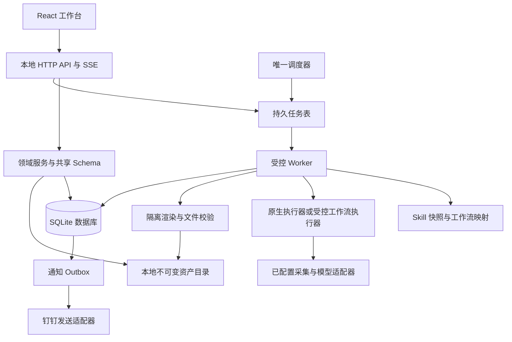
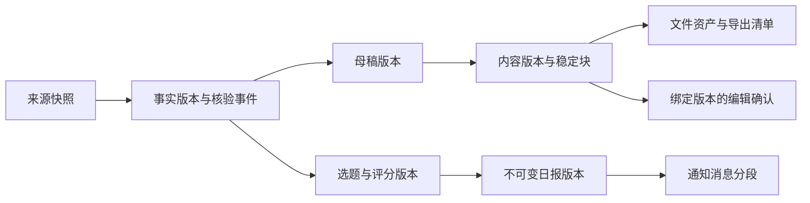
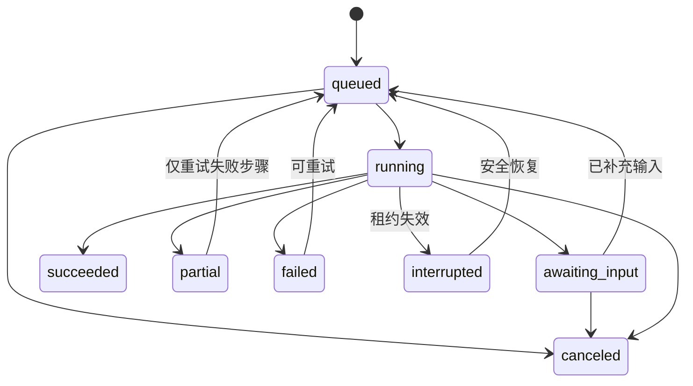

# EcuStudio教创工作台开发设计与实施文档

> 实施更新（2026-11-08，文档1.2）：用户已授权开发、启动和测试，并指定 DeepSeek 内置 Agent。本文保留1.1需求/设计基线；当前实现和外部条件见[04 DeepSeek Agent实施补充](04_DeepSeek_Agent实施补充.md)及应用验收报告。本文原有“未执行/仅文档”指最初文档阶段，不代表当前状态。

版本：1.1 ｜ 日期：2026-11-08 ｜ 状态：建议技术基线，待实现验证  
对应需求：《01_产品需求文档_PRD》R01—R13  
目标读者：前后端开发、AI 工作流工程师、测试与维护人员

本方案以本地模块化单体承载情报、核验、项目、任务和导出，使用不可变版本连接证据与成果。优先复用实际存在的工程和 Skill；若只有三份提示词，则新建工作流包并标明来源。本文定义待实现的接口、表结构与启动约定，不表示这些代码或命令已存在。

## 1 架构与运行边界



一个本地应用、一套数据库、一个受控 worker；API、调度协调器和 worker 可由启动器管理为独立进程。重型渲染放入子进程，避免阻塞 API。SQLite 只在同机本地磁盘使用；生产模式后端同时提供前端构建文件与 API。浏览器关闭不取消任务，后台进程退出才停止执行。

### 1.1 技术基线

| 层 | 建议选型 | 选择理由与验证要求 |
|---|---|---|
| Web | React、TypeScript、Vite | 对应 S3；构建为静态资源；已有成熟前端可复用 |
| API | TypeScript、Fastify | 使用共享 JSON Schema 校验请求与响应，Schema 只来自受信代码 |
| 数据 | SQLite、迁移文件、参数化 SQL | 单用户事务与关联查询；具体 Node 驱动需验证平台安装和备份 API |
| Schema | JSON Schema 为契约源，生成或同步 TypeScript 类型 | 固定 schemaVersion；禁止前后端各自维护冲突枚举 |
| 任务 | SQLite 任务表、一个 worker、租约和检查点 | 避免 Redis 与分布式运维；渲染在受控子进程中执行 |
| 进度 | SSE 与任务查询 API | 服务端事件持久化、可重放；浏览器不维护调度逻辑 |
| 文件 | docx、PptxGenJS、Playwright/Chromium PDF | 从结构化内容生成真实文件；渲染与字体环境单独探测 |
| 验证 | 业务单元测试、SQLite 集成测试、Playwright 界面测试 | 验证不变量、异常恢复和真实文件，不追求空泛覆盖率 |

本次查阅官方资料确认了 Fastify Schema 校验、SQLite WAL 同机约束与备份接口、docx/PptxGenJS 文件生成、PPT 备注和 Playwright PDF 能力；不等于本机已安装或版本兼容已测。实施 M0 按实际选择受支持 Node LTS、依赖精确版本、许可证和浏览器版本，提交锁文件与 `engines`，不直接使用浮动 latest。详见第 16 节官方依据。

### 1.2 建议工程布局

```text
D:\EduStudio\
├── 三份原始需求 Markdown 文件
├── docs\                         本套文档
├── app\                          待开发工程，不在本次文档任务中创建
│   ├── apps\web\
│   ├── apps\server\
│   ├── packages\shared\         Schema、枚举、通用类型
│   ├── packages\workflows\      注册、输入输出与执行器
│   ├── packages\exporters\
│   ├── skills\educontent-studio\
│   ├── migrations\
│   ├── tests\fixtures\          合成样例与真实脱敏样例分开
│   ├── scripts\                 启停、备份、检查
│   └── docs\                    运行能力、集成与实测报告
└── data\                         待初始化，用户可指定其他本地目录
    ├── app.sqlite
    ├── assets\sha256\
    ├── skill-snapshots\
    ├── staging\                  未登记临时成果
    ├── logs\
    └── manifests\
```

密钥不放在上述源码、资产或备份目录。优先使用操作系统凭据库；无可用凭据库时使用受权限保护的服务端配置并明确限制。数据目录禁止放前端 public、网络共享或构建目录。历史成果默认保留；临时文件清理须避开活动任务和备份保留引用。

## 2 领域模型与不变量

ID 建议使用 UUID 字符串；时间点统一 UTC ISO 8601，界面按 Asia/Shanghai。仅日期的政策字段存 `YYYY-MM-DD` 和精度类型，不转成虚假的午夜时间；未知值为 null。招生年度、学年、发布日期分别保存。

### 2.1 表与关键字段

下表为逻辑表设计；字段类型、索引与外键在迁移中落实。正文可存带 schemaVersion 的 JSON，筛选和关系字段必须独立列。

| 表 | 核心字段与约束 |
|---|---|
| sources | id、name、grade A/B/C、publisher、adapterType、entryUrl、region、enabled、configVersion、lastSuccessAt、lastError；配置版本单独快照 |
| source_snapshots | id、sourceId、originalUrl、canonicalUrl、title、publisher、publishedDate/precision、pageUpdatedAt、fetchedAt、bodyAssetId、bodyHash、parseState、metadataJson；UNIQUE(sourceId, canonicalUrl, bodyHash) |
| snapshot_relations | fromId、toId、type转载/修订/附件、依据；禁止修订循环 |
| policy_items | id、title、region、district、stage、policyYear、schoolYear、documentNo、documentType、effectiveDate、expiryDate、lifecycleState |
| policy_snapshots | policyId、snapshotId、relationType，关联政策与多份证据 |
| claim_versions | id、claimId、versionNo、policyId、text、typedValueJson、scopeJson、importance、createdAt；UNIQUE(claimId, versionNo)，不可变 |
| claim_evidence | claimVersionId、snapshotId、locatorType、locatorJson、quote、quoteHash、independenceGroup；原文定位必须可解析 |
| verification_events | id、claimVersionId、status、method、actor、reason、evidenceSetHash、createdAt；追加记录，现态由最新有效事件投影 |
| policy_relations | oldPolicyId、newPolicyId、relationType替代/修订/撤销、evidenceId、reviewRecord；不能仅靠时间推断 |
| topics | id、policyId可空、title、summary、audience、anglesJson、formatsJson、lifecycleState、isDeferred、isFavorite、note、revision、updatedAt |
| topic_score_versions | id、topicId、ruleVersion、scoresJson、reasonsJson、evidenceRefsJson、total、createdAt；总分校验范围 |
| topic_claims | topicId、claimVersionId、role关键/背景；支持门禁与关联查询 |
| projects | id、topicId可空、name、region、district、stage、policyYear、audience、settingsJson、revision、archivedAt |
| master_versions | id、projectId、versionNo、parentId、schemaVersion、bodyJson、dependencyHash、createdBy、createdAt；UNIQUE(projectId, versionNo) |
| master_claims | masterVersionId、claimVersionId；固定事实版本而非当前值 |
| content_versions | id、projectId、kind、versionNo、parentId、masterVersionId、bodyJson、dependencyHash、schemaVersion、createdBy、createdAt |
| content_citations | contentVersionId、blockId、claimVersionId；引用必须属于该母稿上下文 |
| editorial_reviews | id、entityType、entityVersionId、decision、reviewedDependencyHash、actor、createdAt、reason；不能从旧版本复制确认 |
| stale_dependencies | entityVersionId、changedDependencyId、detectedAt、resolution；新证据变化不改写旧版本正文 |
| assets | id、relativePath、sha256、mime、size、kind、ownerProjectId可空、createdAt；path 唯一，文件不可变 |
| character_profile_versions | id、profileId、versionNo、identityJson、voiceJson、styleJson；参考图通过 asset_links 关联 |
| asset_links | assetId、entityType、entityVersionId、role；用于项目、品牌、角色、附件归属 |
| artifacts | id、assetId、targetType、targetVersionId、exportMode、scopeHash、manifestJson、qualityJson、jobId、createdAt |
| daily_report_versions | id、reportDate、versionNo、windowStart、windowEnd、runId、configHash、payloadJson、payloadHash、coverageState、committedAt；UNIQUE(reportDate, versionNo) |
| daily_report_items | reportVersionId、topicId、scoreVersionId、policySnapshotId；正文、标题与事实同时冻结在 payload 中 |
| report_heads | reportDate、latestCommittedVersionId；与日报提交同事务更新 |
| jobs | id、type、state、inputJson、inputHash、idempotencyScope、idempotencyKey、stage、attempt、leaseOwner、leaseUntil、fencingToken、checkpointJson、resultJson、errorJson、cancelRequestedAt、createdAt/startedAt/finishedAt |
| job_events | jobId、seq、eventType、payloadJson、createdAt；UNIQUE(jobId, seq)，事件不含密钥 |
| schedules | id、enabled、timezone、localTime、cadence、nextDueAt、misfirePolicy、executorType、externalTaskId可空、revision |
| schedule_occurrences | scheduleId、scheduledForUtc、jobId、state；UNIQUE(scheduleId, scheduledForUtc) |
| notification_outbox | id、reportVersionId、targetRef、authorizationVersion、messageHash、partNo、partCount、state、attempt、providerMessageId、lastError；组合唯一键见第 8 节 |
| settings_versions | id、section、versionNo、valueJson不含密钥、createdAt；运行固定版本 |
| skill_versions | id、skillId、version、hash、snapshotPath、origin、workflowsJson、capabilitiesJson、validationState |
| audit_events | id、action、actor、entityRef、beforeHash、afterHash、reason、createdAt；不写敏感原文 |

多态版本引用由应用服务加 CHECK 与事务校验；可拆成实体专用引用表时优先外键。启用外键检查；版本与被引用资产禁止级联删除。项目归档不删除证据。索引至少覆盖政策地区/学段/年度、时间、claimId、项目版本、任务 state/leaseUntil、发送 state 和来源哈希。

### 2.2 必须保持的关系



1. 文件只引用提交过的内容版本；引用不指向可变的“最新内容”。
2. 事实更正创建新 claim 版本；核验事件可撤回既有结论但保留审计。两者都触发依赖过期评估。
3. 历史日报自含标题、分析、分数、来源及关联版本，不能通过当前 topic 文本回填。
4. 可发布资格在导出请求与最终登记两处校验；依赖中途更新则拒绝正式登记或改为明确的草稿，不静默发布。
5. 所有可变编辑头带 revision；内容提交事务先校验 expectedRevision，再递增。
6. 一个幂等任务只提交一次目标版本；不同明确重新生成请求使用不同幂等键。

### 2.3 内容结构示例

以下是合成结构示例，值不构成真实政策内容。

```json
{
  "schemaVersion": "1.0",
  "projectId": "project-example",
  "masterVersionId": "master-example-v1",
  "kind": "speech",
  "targetDurationSeconds": 90,
  "blocks": [
    {
      "id": "block-intro",
      "type": "narration",
      "text": "示例开场，不包含具体政策结论。",
      "claimVersionIds": [],
      "locked": false
    }
  ],
  "unverifiedItems": [],
  "durationEstimate": { "method": "spoken-units-per-minute", "rate": 240 }
}
```

PPT 使用稳定 slideId、title、elements、speakerNotes、claimVersionIds、layoutId；分镜使用 shotId、durationSeconds、characterVersionIds、scene、action、camera、lighting、dialogue、subtitle、continuity、prompt。总分、引用、模型参数与时间都需专门语义校验，JSON 结构合法不足以证明事实正确。

## 3 资料管线与事实门禁

### 3.1 来源适配器

统一接口：`discover(window, config) → candidates`、`fetch(candidate) → rawAsset`、`parse(rawAsset) → parsedSnapshot`。每个结果同时返回可核查 URL、时间来源、解析状态与错误；只有已保存和校验的正文才可作为政策结论证据。

步骤：校验入口 → 有限采集 → 保存原始资产 → 清理文本并生成段落 ID → 提取元数据及预览 → 哈希去重 → 政策归并候选 → 生成新快照 → 提取 claim 候选 → 规则与人工核验。PDF 定位保存页码和文本范围；网页定位保存快照段落 ID、片段和片段哈希，不只保存易漂移的在线 DOM 选择器。

URL 规范化保留语义参数，只删除已知跟踪参数；不把不同附件或查询条件误合并。相同 URL 和哈希复用快照；相同 URL 新哈希形成修订候选；跨站相同正文记录转载，保留原始来源。旧政策出现在新列表中不能因此计为新政策。

来源请求建议初值：每主机并发 1、请求间隔至少 1 秒、单次超时 30 秒、最多 2 次重试，遵循实际站点限制取更严格值。403/验证码/登录限制停止并提示人工材料；429 尊重可用 Retry-After。不要对所有错误无限重试。

### 3.2 核验策略

权威来源是证据优先级，不是自动核验结果。claim 候选经 Schema、引用存在性、精确摘录、日期/数字、适用范围和冲突检查后，再根据规则进入已核实或待人工核验。自动验证必须记录规则 ID 与证据，不能依赖模型自报 confidence。复杂资格与替代关系默认人工核验。

正式推荐门禁：参与推荐的政策关键 claim 全部为 verified，范围与时效明确，无未解决冲突，无已排除依赖。一般评论按 opinion 标记，不伪装成条款。可发布成果门禁再增加有效编辑确认、依赖未过期、无阻断质量错误。门禁失败返回具体 claimId 和修复入口。

### 3.3 评分规则建议 v1

每一维使用 0、1、2、3、4 五档，折算 `dimensionScore = weight × level / 4`，总分四舍五入到一位小数。每档必须有依据；无依据记 0 并说明，不能由模型补造。模型仅建议档位与理由，服务端校验并保存规则版本。

| 维度 | 档位参考 |
|---|---|
| 相关性 | 0 无关；1 泛教育；2 国家相关背景；3 北京相关学段；4 直接影响目标区县／人群 |
| 时效性 | 4 ≤24h；3 ≤48h；2 ≤72h；1 ≤7d；0 超窗或未知；长期政策可人工策划但不伪装当日新消息 |
| 实际影响 | 0 不明确；1 认知背景；2 局部参考；3 影响规划；4 直接影响资格、关键节点或重要决策 |
| 内容价值 | 0 无明确受众问题；1 简单告知；2 有解释空间；3 有可验证的新角度；4 重要且易误解、可形成完整解释 |
| 完整度 | 0 关键材料缺失；1 仅线索；2 部分证据；3 证据齐全但行动建议有限；4 条件、例外、时间和行动依据完整 |

仅正式合格池排序。默认总分降序，同分按已知发布时间降序，再按稳定 ID；重要度用可配置阈值，默认高≥80、中60—79.9、低<60。修订内容的时效以确证修订时间评估并标注“修订”。规则可调，修改后产生新评分版本，不重写历史日报。

## 4 Skill 与工作流执行器

### 4.1 注册和能力检查

先查当前工程、用户提供路径与宿主公开 Skill 路径，不扫描无关私人目录。原包只读保留；计算每文件哈希和总 manifest 哈希，复制为不可变 skill-snapshot。工作流映射声明 workflowId、输入输出 Schema、所需工具、模板路径、验证器与执行预算。

基础映射：`policy.research`、`topic.plan`、`master.compose`、`speech.generate`、`wechat.generate`、`presentation.generate`、`storyboard.generate`、`character.compose`、`quality.check`。只加载当前任务需要的模板。提供至少五份启动模板；提示词编写规范与脚本执行权限分开管理。

能力状态使用 `available / limited / needs_configuration / unavailable / untested`。注册成功只代表导入完成；运行验证记录另存 probeRunId、时间、输入摘要、产物与错误。更换 Skill 版本只影响新任务；运行中任务读取已固定快照。

ZIP 导入在 staging 解压，检查总大小、压缩比、文件数、路径规范化、链接和依赖。拒绝绝对路径、`..` 越界、Windows 设备名和越界符号链接，不运行包内安装脚本。导入包不得覆盖用户原 Skill。

### 4.2 执行契约

```ts
interface WorkflowRequest {
  schemaVersion: '1.0';
  projectId: string;
  workflowId: string;
  skill: { id: string; version: string; hash: string };
  context: {
    topic: string; region: string; district?: string;
    stage: string; policyYear?: number; audience: string;
    sourceSnapshotIds: string[]; masterVersionId?: string;
    confirmedConstraints: string[];
  };
  output: {
    kinds: string[]; durationSeconds?: number;
    slideCount?: number; lectureMinutes?: number;
    brandVersionId?: string; characterVersionIds?: string[];
  };
  allowedTools: string[];
  budget: {
    maxModelRequests: number; maxToolCalls: number;
    maxInputChars: number; timeoutSeconds: number; maxRetries: number;
  };
  idempotencyKey: string;
}
interface WorkflowResult {
  runId: string;
  state: 'succeeded' | 'partial' | 'failed' | 'canceled' | 'awaiting_input';
  executor: { kind: 'native' | 'controlled' | 'external_import'; version: string };
  model: string | null;
  usage: { inputTokens: number | null; outputTokens: number | null;
           cost: number | null; currency: string | null };
  structuredContent: unknown;
  citationMap: unknown[];
  unverifiedItems: unknown[];
  qualityChecks: unknown[];
  newVersionIds: string[];
  artifactIds: string[];
  failure?: { stage: string; code: string; message: string; checkpointId?: string };
}
```

原生路径必须以真实 CLI 帮助、SDK 或官方接口为证据。无可用原生接口则实现受控路径，仅允许指定资料读取、已配置检索、claim 提取、母稿/内容候选、文件渲染；模型不执行任意 shell，不自行添加工具或授权。执行器应支持探测、启动、事件、取消与恢复；不支持的能力返回 limited。

建议单创作任务初值：模型请求最多 8 次、工具调用最多 30 次、总输入最多 100000 字符、总时限 20 分钟、重试最多 2 次；单独导出建议 5 分钟超时。每日采集单轮候选建议最多 200 条、AI 分析最多 30 条，超过则明确“本轮截断”并留待后续处理。预算计入重试和子步骤，不允许拆子任务绕过总额度；界面可调整并记录快照。大讲座超预算时请求分批或调整额度，不能静默删内容。

模型返回先做 Schema 校验，最多一次结构修复请求且计入预算；接着验证引用、事实一致性、资产与权限。事实缺失不靠修复提示补造。模型给出的路径永远不能直接登记为资产。

### 4.3 外部任务包

任务包包含 manifest、projectId、baseMasterVersionId、Skill 哈希、必要的授权资料快照、输入约束、结果 Schema 和文件哈希；密钥排除。导入结果检查项目归属、基础版本、所有引用、文件类型和路径。基础版本变化返回冲突并作为候选显示，不能覆盖当前版本；记录 external_import。

## 5 API 与错误契约

所有接口以 `/api/v1` 为前缀。以下为待实现契约；不代表接口已上线。普通读取 200、创建 201、长任务 202，错误统一返回 `error.code/message/details/requestId/retryable`。列表采用稳定排序与 cursor 分页，默认 50、上限 200。时间、枚举、类型与上限来自共享 Schema。

| 方法与路由 | 核心输入 | 返回与行为 |
|---|---|---|
| GET /capabilities | 无 | 执行器、模型、解析、导出与来源能力状态，不返回密钥 |
| GET/POST /sources | 来源配置 | 列表／来源 ID；入口保存与连通性验证分开 |
| PATCH /sources/:id | expectedRevision、变更 | 保存下一轮配置；不修改当前运行快照 |
| POST /imports | URL／文本／已上传 assetId、scope | 202 jobId；解析预览由任务结果查询 |
| POST /uploads | multipart 文件、用途 | assetId；限制类型大小，不能任意指定存储路径 |
| GET /policies | 地区、年度、学段、状态、q、cursor | 情报列表与真实总数口径 |
| GET /snapshots/:id | 无 | 快照元数据、清理后正文、段落／页码定位 |
| GET /policies/:id/changes | fromSnapshotId、toSnapshotId | 可追溯变更，不自动认定替代 |
| POST /claims/:id/verifications | claimVersionId、状态、证据、理由 | 追加核验记录及受影响实体列表 |
| GET/PATCH /topics/:id | expectedRevision、备注等 | topic 与评分版本；冲突返回 409 |
| GET /topics | 分类、筛选、排序、收藏 | cursor 列表，筛选条件可序列化保存 |
| POST /projects | topicId可空、参数、幂等头 | 创建项目并继承快照上下文 |
| GET /projects/:id | 无 | 项目头、各版本与依赖状态 |
| POST /projects/:id/master-versions | baseVersionId、expectedRevision、body | 新母稿版本；不会覆盖历史 |
| POST /content/:id/patch-candidates | baseVersionId、targetBlockIds、指令 | 202 jobId；候选补丁不直接写入已确认稿 |
| POST /content/:id/versions | baseVersionId、expectedRevision、acceptedPatchIds或body | 新内容版本及过期状态 |
| POST /reviews | entityVersionId、dependencyHash、decision、reason | 审核记录；依赖不匹配拒绝 |
| POST /workflows/runs | WorkflowRequest | 202 jobId；缺能力返回明确错误 |
| GET /jobs/:id | 无 | 状态、阶段、checkpoint、结果与可恢复动作 |
| GET /jobs/:id/events | Last-Event-ID或afterSeq | SSE 事件重放 |
| POST /jobs/:id/cancel | 无 | 请求取消；完成前可返回 cancelRequested 状态 |
| POST /jobs/:id/retry | checkpointId可空、幂等头 | 同逻辑任务增加 attempt，仅恢复安全步骤 |
| POST /monitor-runs | 窗口、配置版本、幂等头 | 手动触发与调度相同业务流程 |
| GET /reports | date范围、version | 报告列表；查询具体版本返回固定 payload |
| POST /exports | targetType、targetVersionId或filter、formats、mode | 固定选集后排队；返回 jobId |
| GET /artifacts/:id/download | 无 | 校验归属后流式下载，不接收任意路径 |
| GET/PUT /schedule | enabled、timezone、localTime、expectedRevision | 下次时点、唯一调度源、漏跑策略 |
| POST /notifications/preview | reportVersionId、targetRef | 固定消息内容与 hash，不发送 |
| POST /notifications/send | previewId、previewHash、authorizationVersion | 校验授权和目标后入 outbox |
| POST /notifications/:id/retry | 明确失败状态或已核查结果 | 已成功/结果不明拒绝自动重发 |
| GET/POST /skills | 查询／目录或上传包 assetId | 注册与验证状态、差异；不自动执行脚本 |
| POST /skills/:id/probe | workflowId、测试输入 | 202 jobId；保存真实运行证据 |
| GET/PUT /settings/:section | expectedRevision、非敏感配置 | 返回脱敏配置与生效范围 |
| POST /backups | 范围 | 202 jobId，生成一致性备份及清单 |
| POST /restore/validate | backupAssetId | 临时恢复、校验与影响预览 token |
| POST /restore/commit | validationToken、expectedDataRevision | 明确恢复动作，进入维护模式后替换 |

幂等创建接口使用 `Idempotency-Key` 与服务端计算的请求哈希；同 scope/key 同 hash 返回原资源，不同 hash 返回 409 IDEMPOTENCY_CONFLICT。普通编辑用 expectedRevision 或 If-Match，不能用新幂等键绕过并发校验。

```json
{
  "error": {
    "code": "REVIEW_DEPENDENCY_CHANGED",
    "message": "母稿或引用依据已更新，请复核当前版本。",
    "details": { "entityVersionId": "example-v2", "changedIds": ["example-claim-v3"] },
    "requestId": "example-request",
    "retryable": false
  }
}
```

错误码至少覆盖 VALIDATION_ERROR(400)、FORBIDDEN(403)、NOT_FOUND(404)、VERSION_CONFLICT(409)、REVIEW_REQUIRED(409)、REFERENCE_INVALID(422)、PAYLOAD_TOO_LARGE(413)、CAPABILITY_NOT_CONFIGURED(503)、BUDGET_EXCEEDED、SOURCE_UNAVAILABLE、RENDER_FAILED、DELIVERY_UNKNOWN。业务任务失败由 job.error 记录，不把已接受的任务伪装成 HTTP 成功且业务已完成。

## 6 任务状态与恢复

### 6.1 状态机



建议租约 60 秒、心跳 10 秒。worker 在短事务中领取一条任务并递增 fencingToken；写入检查点与结果时核验 token 和租约归属。旧 worker 即使苏醒也不能提交已失去租约的任务。数据库事务不跨网络调用或模型调用。

阶段：prepare、collect、verify、analyze、compose、validate、commit、notify；具体工作流可用其中子集。每步把已验证中间资产和输入哈希写入 checkpoint。只有可重入且无外部副作用的步骤自动恢复；输入改变应新建运行。

取消为合作式：保存 cancelRequestedAt，停止新工具调用，取消可取消的外部请求，在下一安全边界结束。已原子提交的日报不回滚；已发送消息无法撤销，记录真实情况。未提交候选可以保留为可恢复草稿，但不能登记为可发布成果。

网络重试建议 2 次，指数退避加抖动；格式错误、授权缺失、引用非法不盲目重试。外部付费请求结果不明时先查供应方状态，无法查明则等待人工处理；应用侧幂等不保证外部服务只计费一次。

### 6.2 事件与断线

每个任务事件有递增 seq，状态变更与事件同事务写入。SSE `id` 使用 jobId:seq，payload 含 state、stage、message、时间及真实进度字段。只有知道总工作量时返回 current/total，否则只显示阶段和耗时。

客户端用 Last-Event-ID 续订；事件已过保留范围时返回 reset 提示并查询任务快照，再续订。SSE 掉线仅改变“连接状态”，不把运行任务改成失败。页面恢复后先查任务现态，再补事件。

## 7 每日调度与日报提交

保存 localTime=`09:00`、timezone=`Asia/Shanghai` 与 nextDueAt UTC，使用可注入时钟。调度 tick 在事务中创建唯一 occurrence 和 job；UNIQUE(scheduleId, scheduledForUtc) 抵抗热重载与重复进程。内置与原生调度通过 executorType 互斥，原生仅在接口已验证时启用。

漏跑：恢复时计算当前时刻之前 24 小时内最近一次应运行时点，若无 occurrence 则补跑一次；超过 24 小时仅记录 missed。故障恢复的任务固定原计划窗口并记录 actualStartedAt；用户手动更新则使用新窗口。不得给过去每一天伪造已执行日报。

日报流程：固定配置/窗口 → 采集与覆盖统计 → 快照/去重/核验 → 推荐候选 → 生成完整 payload → Schema 与门禁校验 → 单事务写日报版本、items、report_heads、审计及必要 outbox 记录 → 发布事件。未启用自动发送只创建预览记录，不创建可投递状态的 outbox。

同一天多次更新递增 versionNo。sourceFailures 写入覆盖信息；全部来源失败不提交“无新增”的成功日报。部分失败可提交 coverage=partial，空结果且来源正常为 no_updates。稿件生成和通知不在日报提交事务中执行。通知耗时不影响数据成功时间。

## 8 钉钉 Outbox

钉钉具体连接方式由实施时的官方接口和可用授权确定，不在本文猜测 Webhook 签名、长度上限或消息参数。适配器定义 probe、render、split、send、queryStatus（若平台支持），并记录能力；连接检查不等于已经发送成功。

状态：draft → pending → sending → sent；明确失败为 failed；超时或断线导致结果不明为 unknown；未授权为 blocked。唯一键 `(reportVersionId, targetRef, messageHash, partNo)`，分段清单冻结 partCount 和每段 hash。

发送前复核目标、消息 hash、授权版本和自动发送开关。仅发送 pending，已 sent 不重发。部分分段成功后只重试明确 failed 的部分；unknown 不自动重试。平台支持查询时核对回执，否则提示用户查群消息；人工确认未收到后再执行明确的重发操作并记录风险与原因，不能承诺网络发送严格 exactly-once。

Webhook/Token 只用服务端 secretRef 读取；日志仅记录目标显示名、reportVersionId、providerMessageId 和错误码。更换目标或消息后旧预览失效。localhost 链接从外发模板中排除，原始公开来源链接保留。

## 9 内容修改与版本一致性

AI 局部修改返回白名单补丁：baseVersionId、目标 blockId/slideId、字段、oldValueHash、newValue、理由与引用变化。只允许预先声明的字段；不接收任意可执行脚本。服务器校验目标存在、范围未越界、旧值哈希匹配、locked 块未被修改。接受补丁时复制为新版本，未命中内容保持字节级或规范化结构一致。

编辑自动保存与“提交候选版本”区分：工作草稿允许频繁保存，确认或生成依赖时冻结为正式版本。草稿同样做 revision 校验。已确认内容的新修改创建未审核版本；“拒绝 AI 修改”不影响原稿。

失效传播以依赖图计算：快照变化 → 引用 claim 的复核提示 → 相关母稿与内容过期 → 关联文件显示依据已更新。旧文件不重写。仅角色服饰变化不得使无关政策事实失效，但引用该角色的分镜需重新检查连续性。质量检查对数字、日期、机构和条件进行规则比较，并输出证据差异；人工可记录误报处置。

口播时长按有效朗读单元和语速估算，建议默认 240 字／分钟，标明估算；标点、舞台指示不直接算朗读，数字和英文按转换规则处理。分镜总时长是各镜头时长之和。两者都不是实测音频时长。

## 10 文件生成与下载

导出请求先固定目标版本或筛选结果的全部 ID/版本、排序、模式和生成配置，生成 exportManifest。后台不得继续分页读取变动中的实时列表。统一 Document AST 描述标题、段落、表格、引用、图片与元信息，分别渲染 MD/HTML/DOCX/PDF；PPT 使用独立 slide AST，JSON 输出原结构，CSV 输出明确列表字段并转义公式风险字符。

HTML 内联样式和获准嵌入资源，清除脚本与危险链接；禁用外部自动加载，保留点击访问原文。PDF 使用专门打印样式、中文字体、页码与链接；浏览器渲染器默认禁用任意外网访问。公众号复制版单独生成便携样式，未经平台实测不标兼容。

文件流程：staging 临时文件 → 检查格式与内容 → 计算 hash → 在同一数据卷原子移动到内容寻址目录 → 事务登记 assets/artifacts → 下载可见。若文件移动后数据库提交失败，会有未引用文件，由带宽限期的清理器回收；反向顺序可能登记不存在文件，应避免。文件登记期间再次检查正式导出门禁。

| 类型 | 最小校验 | 视觉或编辑检查 |
|---|---|---|
| MD/HTML | UTF-8、内容与引用完整、HTML 清理 | 离线打开、手机/打印布局、链接 |
| PDF | 文件签名、页数、可提取内容、链接注释 | 每页中文、截断、分页、页码 |
| DOCX | ZIP/OOXML、正文、表格、关系与超链接 | 可打开与编辑；渲染检查全部页 |
| PPTX | ZIP/OOXML、幻灯片、文本、notes、资源关系 | 逐页渲染，文字图形可编辑，备注与正文一致 |
| JSON/CSV | Schema 版本、范围、字段、转义、记录数量 | 用可用工具打开，中文无乱码 |

无法渲染则 quality.visual.status=`unverified` 并写原因；不以 OOXML 通过替代视觉通过。下载端只接收 artifactId，验证归属与真实文件，Content-Disposition 文件名安全编码；禁止暴露内部绝对路径。文件不存在或 hash 不符时标记损坏并提示重生成。

## 11 安全与数据边界

默认绑定 `127.0.0.1`，同时严格校验 Host、Origin 和写请求 CSRF token。首次本地启动建立不可预测会话，不把 token 放可分享 URL；不允许任意跨域访问。localhost 无登录不等于无需防护。

资料抓取仅 HTTP/HTTPS；解析 DNS 后拒绝内网、回环、链路本地和云元数据目的地址，逐跳重定向重新校验，并防止 DNS 重绑定。明确配置的本地模型地址用独立白名单，不复用资料 URL 路由。请求不得携带用户浏览器 Cookie 或系统凭据。

上传检查魔数、类型、大小、解压后规模和路径归属。建议单文件 50MB、ZIP 解压总量 200MB、最多 2000 文件，均为可配置初值。目录选择由用户界面确认并在服务端解析真实路径；禁止路径穿越、符号链接越界、覆盖源码或系统目录。数据库查询参数化。

外部网页、资料、模型输出中的“忽略指令”“运行命令”等均作为正文，不授予工具权限。Schema 编译器只使用应用静态 Schema，不把上传内容作为可执行 Schema。HTML/Markdown 在显示与导出时都清理。原生 CLI 适配器使用参数数组启动固定命令，禁止拼接模型提供的 shell。

数据发送前显示模型服务与资料范围，遵循明确授权；敏感学生信息不进入公开示例。日志、任务包和备份默认排除凭据，错误栈也脱敏。保留政策必要引用，公开交付不默认打包原文全文。原始附件、事实和成果的删除先做依赖检查并提供归档或可恢复操作。

## 12 数据迁移与备份恢复

迁移有顺序号和 checksum，运行前检查现有 schemaVersion、空间和一致备份。迁移失败回滚事务或从验证过的备份恢复，不自动删除数据库。SQLite 设置 foreign_keys、WAL 与有限 busy_timeout；写事务尽量短，繁忙错误有限重试。驱动版本需核实当前官方修复信息，不能仅凭功能可用选择旧引擎。

在线备份使用驱动实际支持的一致性备份 API。先建立备份保留标记阻止相关资产清理，生成数据库快照，再从该快照列出精确资产集合，逐一复制不可变文件并计算哈希。manifest 含 schemaVersion、应用版本、备份时间、数据库哈希、资产清单和排除凭据说明。写入中的 WAL 数据库不能只复制主文件。

恢复步骤：选择备份 → staging 校验哈希与清单 → 打开临时数据库完整性/外键检查 → 验证所有引用资产 → 必要迁移并试读 → 显示替换范围 → 用户明确提交 → 停调度/worker 与写入 → 保存当前恢复点 → 替换数据目录 → 重启自检。失败回到原目录；不让新旧数据库和资产混搭。恢复后通知发送默认暂停，检查授权与历史 outbox，避免旧备份触发重复外发。

## 13 启停与维护约定

以下命令是未来工程应提供的接口约定，本次没有实现或运行这些命令：

| 约定 | 实施责任 |
|---|---|
| `npm ci` | 安装锁定依赖，报告 Node/驱动/浏览器条件 |
| `npm run setup` | 初始化指定数据目录、迁移、能力检查；不覆盖已有数据 |
| `npm run dev` | 一条命令管理开发 API、前端与 worker |
| `npm run build` | 构建生产静态文件和服务端 |
| `npm start` | 同源生产入口与受控 worker；输出真实本地地址 |
| `npm run check` | 类型、静态检查与关键业务测试 |
| `npm run test:e2e` | 测试隔离数据目录，不发送真实群消息 |
| `npm run backup` | 与界面共用一致备份服务 |

Windows 启动脚本与 macOS 说明必须注明实测系统。端口占用时清楚提示或选择空闲端口并显示真实地址，不杀未知进程。优雅关闭停止领取新任务，等待安全检查点并释放租约。可选开机启动属于另行启用功能，不默认修改系统配置。

结构化日志含 requestId、jobId、attempt、stage、durationMs、errorCode，采集/解析/模型/文件/通知分别统计。异常归档保留定位信息，正文与凭据不默认记录。建议日志轮转 30 天，审计、版本和历史日报默认保留；清理策略须可见且不影响可复现性。

## 14 架构决策记录

以下 ADR 状态均为 Proposed，表示本套文档建议，不冒充用户已批准。

| ADR | 背景与决定 | 代价与备选 | 重新评估条件 |
|---|---|---|---|
| ADR-001 本地模块化单体 | S3 单用户、本地归属；采用一套服务与 SQLite | 同机写入需协调、不能关机运行；未选云微服务/Redis，减少运维 | 明确多人公网需求 |
| ADR-002 TypeScript 基线 | 新工程采用 React/Vite/Fastify，共享 Schema | Node SQLite 驱动和渲染器需验证；已有 Python 稳定工程可复用 | M0 发现成熟可用工程 |
| ADR-003 双执行器契约 | 主路径择一真实实现，原生或受控，统一输入输出 | 需维护适配与能力差异；不依赖假定 WorkBuddy API | 宿主提供稳定可验证接口 |
| ADR-004 不可变版本与显式审核 | 事实、母稿、内容、日报冻结，审核绑定版本 | 占用更多存储、交互更复杂；未选覆盖式保存 | 需新归档策略，不放弃追溯 |
| ADR-005 持久任务与独立通知 | 任务租约/幂等/检查点；消息用 outbox | 需处理 unknown 发送结果；不承诺跨系统严格只发一次 | 平台支持可靠幂等与回执查询 |
| ADR-006 SQLite 与独立资产 | 关系与事务存库，文件内容寻址，备份 manifest 对齐 | 需要垃圾回收和恢复校验；未选全部 JSON 或 BLOB 堆积 | 数据规模超实测基线 |
| ADR-007 受控渲染与真实文件 | 结构化内容经专用导出器，渲染在子进程 | 字体/浏览器/Office 预览依赖需管理；未选截图冒充可编辑文件 | 新模板或导出器需要复验 |
| ADR-008 唯一调度来源 | 默认内置持久调度，验证原生后可切换 | 本地在线依赖保留；不双开计划 | 用户明确需要远程常驻运行 |

## 15 实施工作包与完成定义

| 工作包 | 依赖 | 主要产物 | 验收映射 |
|---|---|---|---|
| W01 环境与骨架 | 无 | 能力清单、Skill 查验、版本锁、Schema、迁移、基础启动 | A01、A02 |
| W02 资料与核验 | W01 | 导入、来源适配器、快照、claim、定位、修订 | A03—A05、A17 |
| W03 选题与项目 | W02 | 评分、项目、母稿、并发与审核基础 | A06、A18 |
| W04 执行器与创作 | W03 | 真实调用、候选补丁、全部核心工作流、角色 | A07—A09 |
| W05 导出 | W03，创作文件验证依赖 W04 | AST、文件校验、预览、下载、导出范围 | A10、A18 |
| W06 日报与运行 | W02—W03，任务基础在 W01 建立 | 租约/恢复、每日调度、日报、SSE | A11—A12、A16 |
| W07 通知与备份 | W06、W05 | 钉钉适配、授权状态、outbox、备份恢复 | A13—A14 |
| W08 体验与交付 | W01—W07 | 响应式、生产启动、操作说明、实测证据 | A01—A18 |

每个工作包完成须具备可运行行为、真实状态、失败提示、相关业务验证与简短实施记录。没有开发人力、模型额度和交付日信息，不在本文承诺人天；M0 后根据实际依赖与试验结果排期。

最终工程应交付源码、锁文件、迁移、配置样例、Skill/适配器、启动脚本、公开或脱敏样例，以及 README、ENV_CAPABILITIES、SKILL_INTEGRATION、ACCEPTANCE_REPORT、DATA_AND_BACKUP、DEVELOPMENT_HANDOFF。报告的通过/失败/未测/待条件验证必须与证据一致。

## 16 官方技术依据

查阅日期：2026-11-08。以下支持技术能力与约束，不证明部署环境现状。实际依赖版本、许可证与组合兼容性在安装时再次核验并锁定。

- Vite 提供开发服务器和生产构建能力，运行条件按选定版本检查：[Vite 指南](https://vite.dev/guide/)。
- Fastify 支持请求校验与响应序列化；Schema 视作受信应用代码，不能接受用户任意 Schema：[Fastify 校验文档](https://fastify.dev/docs/latest/Reference/Validation-and-Serialization/)。
- WAL 需要同机共享状态，不适用于跨机器网络文件系统；还须检查引擎当前修复说明：[SQLite WAL](https://www.sqlite.org/wal.html)。
- 一致在线快照采用受支持的备份接口：[SQLite Backup API](https://www.sqlite.org/backup.html)。
- DOCX 生成候选库提供 JS/TS 接口：[docx 官方仓库](https://github.com/dolanmiu/docx)。
- PPTX 生成支持文字、表格、形状等对象，备注另有接口：[PptxGenJS 介绍](https://gitbrent.github.io/PptxGenJS/docs/introduction/)、[讲者备注文档](https://gitbrent.github.io/PptxGenJS/docs/speaker-notes/)。
- PDF 导出使用页面打印能力并应用打印样式，实际浏览器依赖需探测：[Playwright page.pdf](https://playwright.dev/docs/api/class-page#page-pdf)。

