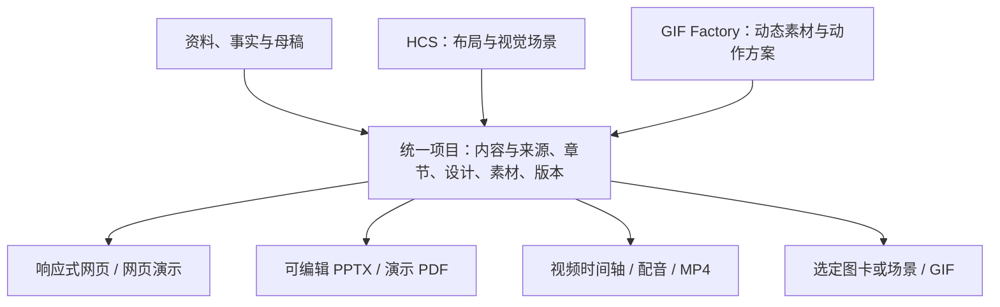

# EcuStudio 视觉创作统一适配方案

日期：2026-11-15。状态：已按方案实现 0.7.0 的共享视觉主流程；以下保留设计依据与阶段规划，具体已实现范围和验证结论见《0.7.0开发与验证记录.md》。

## 结论

HTML Creator Studio（HCS）与 GIF Factory 可以互补，但二者在视觉设计、分镜、视频制作和检查流程上有重叠。直接将两套完整流程同时交给 Agent，容易产生重复规划、不同文案、不同时间轴、重复渲染和重复确认。

建议扩展 EcuStudio 现有创作项目：由工作台统一管理事实、版本、权限、素材、制作计划和输出；HCS 提供版式、视觉场景与跨画幅设计方法；GIF Factory 提供动态素材和动作叙事方法；现有导出器扩展成网页、PPTX、视频与 GIF 的输出适配器。用户选择交付物，工作台决定调用哪些技能。

“网页可以形成 PPT”应成为同一项目内的正式工作流。对于工作台生成的网页，利用保留的结构化内容与视觉设计生成演示稿；对于外部网页，先导入、提取内容和素材，再分页重排。两者均不承诺任意 HTML、CSS、JavaScript 无损转换成可编辑 PowerPoint。

## 1. 开发前核对的基线

| 模块 | 当前已有 | 需要补齐 |
|---|---|---|
| 一句话任务管家 | ACKS 优化任务，选择资料，共用研究与母稿，按输出生成内容版本 | 增加视觉计划与能力路由，避免每种格式重新制作全部内容 |
| HCS 接入 | 读取真实技能；工作台执行受控设计参数，支持 editorial/cards/timeline；桌面、手机预览 | 技能中定义的完整场景、素材与逐帧时间轴尚未全部成为宿主能力 |
| 网页 | 普通文档 HTML 与视觉 HTML 两条输出路径 | 区分“文档版”与“视觉版”，共享内容来源，避免用户混淆 |
| PPTX | PptxGenJS 生成真实 PPTX；可编辑文字、简单图形、讲者备注、引用 | 版式目前固定；未共享视觉 HTML 的设计，也未承接其动态素材 |
| PDF | 当前通过文档 HTML 输出 A4 讲义 | 增加与演示稿同分页的演示 PDF，保留现有讲义用途 |
| 视频 | Chromium + FFmpeg 输出无声 MP4；文字场景依次切换；批准绑定具体内容与视觉版本 | 可寻址动画、分层素材、实际配音时间轴、字幕与音频合成 |
| 配音 | 现有文件与语音模块可生成配音文件 | 还需与具体视频场景、字幕和修订绑定；当前返回音频不等于已有逐词时间戳 |
| GIF Factory | 本次核对上游导出脚本和技能规范，尚未接入工作台执行器 | 注册受控工具、补运行依赖、导入素材、建立统一资产协议 |

代码依据：`server/workflow-agent.ts`、`server/workflows.ts`、`server/visual-studio.ts`、`server/render.ts`、`server/exports.ts`、`server/media.ts`、`shared/workflows.ts`。

重要区分：HCS 包含完整方法说明，不等于工作台已实现所有方法；安装 GIF Factory 文档同样不等于获得通用视频生成服务。

## 2. 职责与重叠处理

| 环节 | 主责 | 补充方式与边界 |
|---|---|---|
| 用户要求、交付清单、任务拆解 | 现有任务管家 + ACKS | 技能不能各自重启一个独立项目 |
| 政策事实、条件、引用与版本 | 现有研究、母稿、来源预审 | HCS/GIF Factory 可建议表达方法，不得自行改写事实依据 |
| 项目配色、字体、版式与跨画幅构图 | HCS 方法 + 工作台统一设计数据 | GIF Factory 风格在项目方向内应用；机构品牌样式与“书院/曜石”操作界面主题分别存储 |
| 图卡、角色姿态、签名、标题动效 | GIF Factory 适配器 | 产物作为项目素材，可被网页、演示和视频复用 |
| 流程图、信息图、普通转场 | 工作台共享视觉组件 | 优先复用 HCS/宿主已具备的 DOM/SVG 能力，不强制绕经 GIF 导出 |
| 整片故事、动作和镜头建议 | 按任务选择 HCS 或 GIF Factory 相关方法 | 同一场景只合并成一份最终分镜，不允许两套建议分别控制成片 |
| 总时长、字幕、音频、场景顺序 | 工作台统一时间轴 | 子素材提供自身时长和动作标记；不能自行改变整片时间 |
| 实际视频渲染 | 一个明确选定的宿主渲染适配器 | 第一阶段延续 Chromium + FFmpeg；后续需要时再增加经过验证的引擎；同一输出不重复编码两次 |
| 审核、任务状态、权限与打包 | 工作台现有机制 | 合并记录，按实际版本和变更失效；不复制两套独立确认界面 |

GIF Factory 的品牌宣传片说明本身区分“姿态脚本负责角色资产”与“视频合成工具负责广告时间线”，因此这种分工符合上游设计。

## 3. 共享内容与视觉数据

在现有项目和版本上增加视觉修订，保留以下信息：

- 内容与来源：事实 ID、母稿版本、章节 ID、各输出使用的文案版本、引用与适用条件。
- 设计：项目配色、字体及回退、布局、品牌素材、横版/竖版/手机布局规则。
- 场景：稳定的场景和元素 ID、内容引用、素材引用、元素类型、构图与可编辑性。
- 时间：音频来源、实际长度、句群或逐词时间定位、场景区间、动作与字幕时刻。若服务没有可靠时间戳，需补分句合成或对齐步骤；不能用字数推算冒充实际时间。
- 素材：资产 ID、哈希、来源、授权、尺寸、透明通道、时长、帧率、源文件、静态替代图、所属项目与访问权限。
- 派生关系：哪个网页、PPT 页、视频场景使用了哪个母稿章节、事实、素材和设计版本。

共享内容不意味着所有格式逐字一样。PPT 可以提炼要点，视频可以采用口语，但必须保留适用条件与来源；每个改写后的观众稿都有自己的版本。用户修改共享事实时，将受影响输出标记为待同步；用户只修改某一页布局时，不应重写其他输出。

用户在外部 PowerPoint 修改下载的文件，不会自动回写工作台；重新上传应作为新输入或新版本处理，不能覆盖原项目设计并宣称已完成双向同步。

## 4. 网页到 PPT 的正式路径

### 4.1 工作台内生成的网页

用户点击“生成演示稿”后，工作台读取该网页对应的内容、视觉设计和素材，按讲述目标分页；长网页中的一个章节可以对应多页，网页菜单、按钮等无需照搬。演示稿与网页共享内容和品牌方向，分别采用固定画布与响应式排版。

建议提供两个导出选择：

| 选择 | 处理方式 | 明确限制 |
|---|---|---|
| 可编辑 PPTX，默认 | 文字、基础图形、表格等映射为原生对象；复杂插画保留图片；讲者备注保留讲述与来源 | 不保证网页特效与 PowerPoint 动画逐项对应；明确哪些元素是图片 |
| 外观保留版 | 按演示页构图渲染为图片，再放入 PPTX；需要时叠加可编辑标题 | 页面主体是快照，不标为完全可编辑；不直接将长网页随意切成长截图 |

另提供浏览器演示模式和演示 PDF。浏览器演示可以保留网页交互；PDF 采用静态关键状态；原有 A4 讲义继续保留且名称清楚。

### 4.2 动画的处理

- 网页：使用适合浏览器的 SVG、图像、视频或受控动画，支持关闭动效后的可读状态。
- PPTX：简单信息仍以文字和图形表达；复杂动效可以作为 GIF/视频媒体，配静态封面与说明。跨 PowerPoint 版本、Mac 和其他播放器的播放差异需要实际验证。
- 视频：使用源帧、矢量或高质量素材按总时间轴合成；尽量保留动画源文件，避免把低分辨率 GIF 当所有输出的唯一母素材。
- GIF：作为短循环交付物，从选定场景或资产导出；其循环时长不决定整部视频的时长。

PptxGenJS 已支持图片和媒体，但其内置 HTML 转换面向 HTML 表格，并非任意网页转换器。跨格式能力需要我们定义可转换组件及回退方案。

### 4.3 外部网页

首期建议专注工作台自产网页，确保结构和素材可追溯。外部网页随后通过现有导入、OCR/解析与来源流程进入系统，清理脚本并确认可用素材后重新生成演示稿。不能承诺直接执行外部网页脚本或完整复制其动态效果。

## 5. 当前代码需要处理的具体接点

1. `shared/workflows.ts`：扩展输出选项与每种输出的规格，区分网页、演示、视频、动图。不要把“视频母版已完成”当作“视频文件已完成”。
2. `server/workflow-agent.ts`：按实际任务读取相关技能分支，新增严格 JSON 工具接口；将技能执行权限与模型文字建议分开。模型不获得任意 shell、任意路径或任意网络权限。
3. `server/visual-studio.ts`：从仅有布局/颜色参数升级到受控场景和素材引用；保留文案、来源与版本绑定。当前预览阻止网络请求，新增素材应经授权资产读取与本地打包处理，不能直接放开任意 URL。
4. `server/render.ts`：扩展 PPTX 的原生元素和统一设计映射；增加演示 PDF，现有 A4 讲义单独保留。当前固定字体与颜色需改为项目配置，并处理 Windows/Mac 字体回退。
5. `server/media.ts`：复用现有配音入口和配置，增加可重用音频、时间定位与视频场景绑定；不再创建另一套配音配置。
6. `server/workflows.ts`：制作任务和资产依赖统一编排，保留重试、取消、权限撤销与断点。现有资产幂等查询按 job_id/format 区分，同一任务输出多张 GIF 或多张 PNG 时需要稳定的子步骤/资产键，防止误复用第一张文件。
7. `server/source-review.ts`：把派生关系扩展到场景、图卡和媒体文案。政策变化时标记所有受影响作品，不静默替换已审核文件。
8. 现有创作页面：统一入口和输出预览，不新增第二套与现有项目互不关联的创作系统。

HCS 现有 HyperFrames 交接说明也明确，其旧 DOM 动画示例尚未与另一分支完全统一。因此首期不同时承诺 Chromium、Remotion、HyperFrames 三套引擎等价兼容；先实现一条可靠通路，再增加确有需求的适配器。

## 6. 用户流程与版本规则

建议在现有创作项目中增加“视觉制作”，显示网页、演示、视频、动图四种输出。用户从任务管家、母稿或已有作品进入同一项目，选择目标和规格；系统根据能力选择工具。

示例：同一份政策先做家长说明网页，再生成八页讲座 PPT，抽取报名流程做动图，最后生成配音短片。四种输出共享已选素材与来源，但分别校验信息密度、阅读时间、画幅和播放方式。

改动规则：

- 事实或日期变更：创建新内容版本，标记所有引用它的输出；原交付物保留，生成新版后重新核对受影响内容。
- 只改配色或素材：沿用未变的文案与配音，更新受影响设计和渲染。
- 只改视频节奏：只修改时间轴及相关输出，不重新生成所有文案和图片。
- 只改 PPT 某页：保存为演示版局部调整，除非用户选择同步共享内容。
- 审核记录按内容、设计、素材和时间版本关联。复用已有明确授权；新内容或越出授权范围的外部服务再按实际需要处理。技能中的流程说明不能自行扩大用户授权或伪造批准。

管理员、创作者、业务员继续采用现有权限边界。增加动态素材不会默认给业务员开放创作、私有素材或配置权限。

## 7. 建议实施顺序

### 第一阶段：先打通共享设计与网页/演示

统一内容和视觉数据、素材引用与项目样式；支持自产网页转可编辑 PPTX、演示 PDF和网页演示；接入一类 GIF Factory 素材作为贯通样例。保留现有输出和旧项目，不要求旧项目强制迁移才可使用。

### 第二阶段：扩展动态素材与有声视频

增加政策流程、材料清单、对比图卡、品牌标题等模板；打通 GIF 素材库、视频时间轴、真实音频与字幕、统一内容包及来源变更追踪。

### 第三阶段：按需求增加复杂创意

知识短片、品牌动作叙事、绘本与复杂引擎放到已有共享结构上扩展。Python/Pillow 等依赖只在启用相关能力时准备；不把大量示例媒体强制放入所有安装包，不假定安装 Skill 就具有外部模型额度。

## 8. 实施时的验收重点

以一份有地区、年度、日期与例外条件的政策资料完成贯通验证，避免只做孤立导出测试：

- 同一项目能输出网页、PPTX、演示 PDF、GIF 和带音频的视频，关键事实及引用一致。
- PPTX 中宣称可编辑的文字、图形确实可修改；复杂元素回退有明确提示。
- 修改一个日期能定位受影响输出，不覆盖旧版或误改无关作品。
- 同一任务多张同格式素材不会互相替代；重试不会重复制作已完成的素材。
- 无动效、离线和字体回退时仍能阅读；图片与媒体访问遵循既有账号权限。
- Windows 与 Mac 分别核查安装、生成和实际播放；未进行的原生平台测试如实记录。
- 内容来源核对、视觉检查与文件可打开分别记录，不能把结构通过当作内容准确或观感合格。

以上为方案验收目标。0.7.0 已实现共享网页、原生可编辑 PPT、演示 PDF、GIF 图卡、配音视频与素材复用；复杂创意分支和 Mac 实机验收仍需后续开展。实际结果见本版本开发与验证记录。

## 参考依据

- 本地 HCS：`skills/html-creator-studio/references/CONTRACT.md`、`VIDEO-READY.md`、`ASSET-DIRECTION.md`、`HYPERFRAMES-ADAPTER.md`。
- [GIF Factory 品牌宣传片分工](https://github.com/WoYun520/gif-factory/blob/bd6bc31a6e0bebe2be5f79838613bd8041052481/references/brand-film.md)：当前核对提交 `bd6bc31a6e0bebe2be5f79838613bd8041052481`。
- [GIF Factory 知识短片规范](https://github.com/WoYun520/gif-factory/blob/bd6bc31a6e0bebe2be5f79838613bd8041052481/skills/paper-mechanism-explainer/SKILL.md)。
- [PptxGenJS HTML 转换范围](https://gitbrent.github.io/PptxGenJS/docs/html-to-powerpoint/)。
- [PptxGenJS 图片能力](https://gitbrent.github.io/PptxGenJS/docs/api-images/)。
- [PptxGenJS 媒体能力](https://gitbrent.github.io/PptxGenJS/docs/api-media/)。
